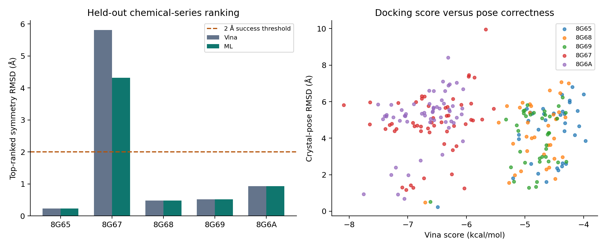
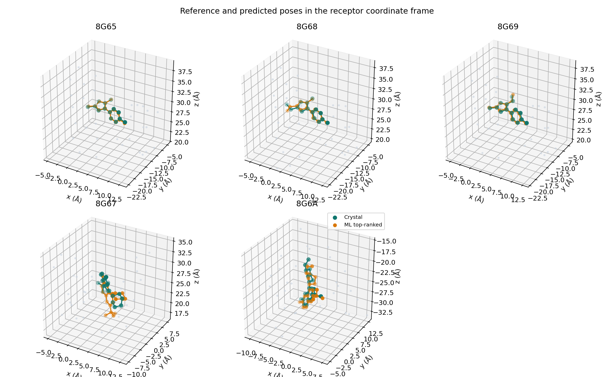
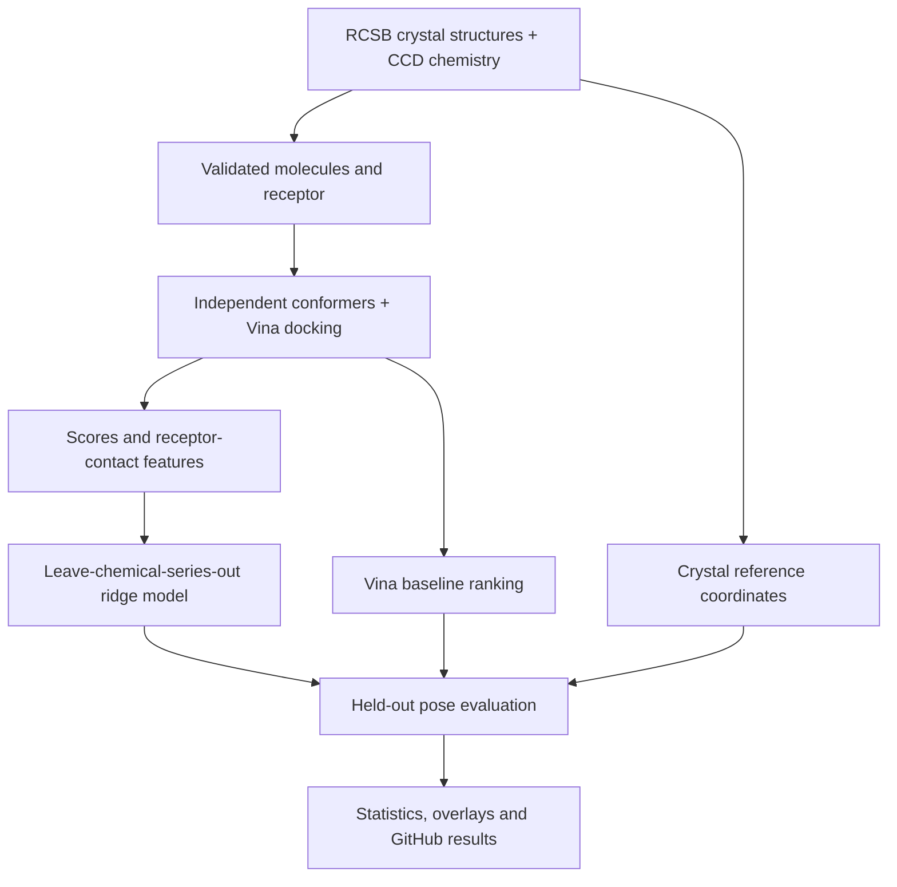

# PTP1B · Allosteric Fragment Pose Ranking

**Experimental structures → molecular docking → interpretable ML → measured pose accuracy**

A reproducible computational study of a specific drug-discovery question:
**can receptor-contact features help rank PTP1B fragment poses better than the
AutoDock Vina score alone?**

PTP1B is a protein involved in insulin signaling. Its allosteric pockets offer a
way to investigate binding away from the catalytic site. This project uses five
experimentally resolved fragment complexes from a D. E. Shaw Research publication
as the reference for a retrospective, known-pocket docking benchmark.

| Experimental reference | Computational method | Evaluation |
|---|---|---|
| Five X-ray structures · two chemical series | Vina docking + ridge regression | Symmetry-aware RMSD · held-out series |

## Results

<!-- RESULTS:START -->
### Measured pose recovery

| Fragment | Candidates | Vina top-1 RMSD (Å) | ML top-1 RMSD (Å) | Best candidate RMSD (Å) |
|---|---:|---:|---:|---:|
| 8G65 | 35 | 0.232 | 0.232 | 0.232 |
| 8G67 | 53 | 5.814 | 4.318 | 1.175 |
| 8G68 | 36 | 0.478 | 0.478 | 0.478 |
| 8G69 | 38 | 0.515 | 0.515 | 0.515 |
| 8G6A | 58 | 0.933 | 0.933 | 0.689 |

| Method | Top-1 recovery ≤ 2 Å | Top-3 recovery ≤ 2 Å |
|---|---:|---:|
| Vina | 4/5 | 4/5 |
| ML | 4/5 | 5/5 |
| Shuffled-label ML | 0/5 | 1/5 |

**Mean paired ML − Vina top-1 RMSD: -0.299 Å.** Negative favors ML.
Descriptive fragment-bootstrap 95% interval: [-0.898, 0.000] Å.
Five related fragments across two chemical series; these results are exploratory.



*Vina versus held-out-series ML, with candidate scores and crystal-pose error.*



*Experimental crystal poses and ML top-ranked candidates in the same receptor coordinate frame.*

[Full analysis](results/REPORT.md) · [Metrics](results/metrics.csv) · [Run provenance](results/manifest.json)
<!-- RESULTS:END -->

To display your existing run on GitHub, put its original files in `results/`
and run `python showcase.py`. Commit the updated README together with the result
files, including both PNGs. The helper requires the completed run's manifest,
summary, metrics and report; it does not generate or invent scientific results.

## What the project measures

- **Pose recovery:** heavy-atom RMSD against the crystal pose, accounting for
  molecular symmetry without independently aligning the ligand.
- **Ranking:** top-1 and top-3 recovery at a 2 Å threshold for Vina and ML.
- **Sampling:** the candidate-pool oracle separates a missing correct pose from
  a correct pose that was ranked poorly.
- **Reliability:** a shuffled-label control and fragment-level paired bootstrap
  supplement the per-fragment results.

## Architecture



Reference coordinates provide the evaluation labels and known docking-box location;
they do not enter the ML feature vector. This is known-site redocking, not blind
pocket discovery.

## Implementation

1. **Ground the study in experimental data.** Download original PDB coordinates
   and chemical-component definitions, validate identities, and record SHA256 hashes.
2. **Generate independent candidates.** RDKit embeds ligand chemistry; Meeko
   prepares ligands, Open Babel prepares the receptor, and Vina samples poses with
   three seeds. No crystal pose is inserted into the candidate pool.
3. **Build an interpretable ranker.** Seven inputs describe Vina score, steric
   overlap, smooth contacts, polar proximity, hydrophobic proximity, nearest-atom
   distance and burial. Standardized ridge regression predicts log(1 + RMSD),
   with fixed alpha=10 and equal total training weight per fragment.
4. **Keep evaluation separate.** An entire chemical series is held out in each
   fold. Candidate deduplication uses a 0.5 Å threshold; figures and statistics
   retain failed cases alongside successful ones.

| File | Responsibility |
|---|---|
| `datasets.csv` · `dataset.py` | Experimental sources, download and validation |
| `pipeline.py` | Structure preparation, docking and scientific outputs |
| `core.py` | Geometry, features, grouped ML and metrics |
| `showcase.py` | Publish completed-run metrics and figures into this README |
| `run.sh` | Run with an environment you supply; no automatic installation |
| `tests/test_project.py` | Unit checks and optional real-data integration checks |

## Run

Prepare your own Python environment. **Python 3.11 is the dependency target.**
There is no requirement to use Conda or Miniforge, and the launcher creates no
environment and installs nothing.

```bash
# In your activated environment, from the repository root:
python -m pip install -r requirements.txt
```

Install the **AutoDock Vina** and **Open Babel** command-line executables separately
using your preferred installation method, and make sure these commands work in
the same terminal:

```bash
vina --version
obabel -V
```

Python requirements do not install those external executables. The original
dependency targets were Vina 1.2.7 and Open Babel 3.1.1; actual versions are recorded
in each run's manifest. Different versions may change numerical results.

```bash
bash run.sh --check-only              # validate your environment
bash run.sh                          # real data → docking → report → README
bash run.sh --cpu 4 --exhaustiveness 32
bash run.sh --offline                # use previously validated data
```

Run the core directly if you prefer:

```bash
python pipeline.py
python showcase.py                  # refresh the README from that completed run
```

Choose an interpreter explicitly with `PYTHON=/path/to/python bash run.sh`.
Initial data downloads need internet. Default docking uses seeds 17, 41 and 83,
exhaustiveness 32, and one CPU. Runtime has not been benchmarked.

## Data and reproducibility

| PDB | Ligand | Chemical series |
|---|---|---|
| [8G65](https://www.rcsb.org/structure/8G65) | YW9 | 1 |
| [8G68](https://www.rcsb.org/structure/8G68) | YXF | 1 |
| [8G69](https://www.rcsb.org/structure/8G69) | YXN | 1 |
| [8G67](https://www.rcsb.org/structure/8G67) | KB8 | 2 |
| [8G6A](https://www.rcsb.org/structure/8G6A) | ZD3 | 2 |

8G6A contains both enantiomers; the protocol uses ZD3 and checks CCD/crystal
stereochemistry. `bash run.sh --download-only` fetches and validates all ten source
files using only standard Python. Their exact URLs are in `datasets.csv`.

Completed runs produce `results/REPORT.md`, `ranking.png`, `ranking.svg`, `poses.png`,
`poses.csv`, `metrics.csv`, `summary.json`, `manifest.json`, `data-quality.json`,
and per-structure pose files and logs. The manifest records code/data hashes,
software versions and run settings.

```bash
python -m pytest -q tests
```

Real-data integration checks require downloaded structures and docking tools;
they skip when the dataset is absent. Unit-test fixtures are not research data.
The full real-data experiment has not been validated in the delivery workspace.

## Scope

Five related fragments and two series support an exploratory case study, not a
generalizable AI-performance claim. The rigid holo receptor and known pocket are
optimistic assumptions. Waters, receptor flexibility and crystal packing are not
modeled. Bootstrap intervals are descriptive; docking scores are not measured
affinities. This project performs no MD and makes no therapeutic-efficacy claim.

**Reference:** Greisman et al. (2023), *Discovery and Validation of the Binding
Poses of Allosteric Fragment Hits to Protein Tyrosine Phosphatase 1b: From Molecular
Dynamics Simulations to X-ray Crystallography*,
[JCIM · DOI: 10.1021/acs.jcim.3c00236](https://doi.org/10.1021/acs.jcim.3c00236).
Code developed with AI assistance.
